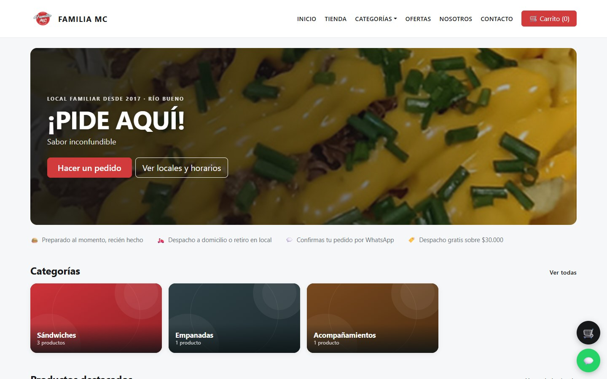

# Portafolio — Alfonso Mena

**En vivo: https://alfonsomenadev-del.github.io**

Sitio personal en HTML, CSS y JavaScript puro. Sin dependencias, sin build, sin `npm install`.

## Publicar cambios

Está en GitHub Pages sobre la rama `main`. Cada push se publica solo en un par de minutos:

```bash
git add -A && git commit -m "describe tu cambio" && git push
```

## Cómo verlo

Haz doble clic en `index.html`. Ya está.

## Estructura

```
Portafolio/
├── index.html        ← todo el contenido (aquí editas textos)
├── css/styles.css    ← todos los estilos
├── js/main.js        ← menú móvil, animaciones, formulario
├── img/              ← pon aquí tus capturas de proyectos
└── cv.pdf            ← tu CV (ya copiado desde Descargas)
```

> Si actualizas tu CV, reemplaza `cv.pdf` conservando ese nombre y el botón
> "Descargar CV" seguirá funcionando sin tocar el HTML.

## Qué editar (busca los comentarios `==== EDITA ESTO ====`)

| Qué | Dónde |
|---|---|
| Tu nombre, título y descripción SEO | `index.html`, dentro de `<head>` |
| Texto del hero | `index.html`, sección `#inicio` |
| Links de GitHub y LinkedIn | `index.html`, bloque `.hero__socials` |
| Tu historia y datos numéricos | `index.html`, sección `#sobre-mi` — ya escritos desde tu CV |
| Proyectos | `index.html`, sección `#proyectos` — ya llenos, ver abajo |
| Skills | `index.html`, sección `#skills` — ya llenos con tu stack real |
| Experiencia laboral | `index.html`, sección `#experiencia` — desde tu CV |
| Títulos y certificaciones | `index.html`, sección `#formacion` — desde tu CV |
| Correo (aparece en 3 sitios) | `index.html` ×2 y `js/main.js` ×1 |

### Agregar un trabajo o una certificación

En `#experiencia`, copia un `<li class="timeline__item reveal">` completo: el punto de
la línea de tiempo se dibuja solo. En `#formacion`, copia un `<li class="cred">`.
En ambos casos el orden es del más reciente al más antiguo.
| Color de acento | `css/styles.css`, variable `--accent` (línea ~18) |

## Proyectos incluidos

Los proyectos están descritos con datos reales y enlazados a los repositorios disponibles:

| # | Proyecto | Stack | Código / captura |
|---|---|---|---|
| 1 | Familia MC — Tienda online | .NET 9, EF Core, SQL Server | Repo privado · ⬜ falta `img/familiamc.jpg` |
| 2 | PuraVisión — CRM móvil | Kotlin, Compose, Room, Firebase | Repo privado · ⬜ falta `img/puravision-crm.jpg` |
| 3 | PuraVisión — Gestión óptica para Windows | Electron, React, PHP, MariaDB | Repo privado · ⬜ falta captura |
| 4 | Chanchito — Finanzas personales | Expo, React Native, TypeScript | ⬜ falta repo y `img/chanchito.jpg` |
| 5 | Comparador de precios + bot | Python, SQLite, Telegram | Repo privado · ⬜ falta `img/comparador-precios.jpg` |
| 6 | POS AMS — Punto de venta | Electron, React, TypeScript, SQLite | Repos de escritorio y Windows 7 · ✅ `img/pos-ams.png` |
| 7 | ControlÓptica — ERP de operativos | Electron, React 19, ExcelJS | ⬜ falta repo y `img/controloptica.jpg` |
| 8 | Óptica Puravisión — Sitio web | .NET 9, ASP.NET Core MVC | Repo privado · ✅ desde producción |
| 9 | KAIROS.CL — Catálogo y cotizaciones | TypeScript, Vite, Node.js, Three.js | Repo privado · ⬜ falta captura |

El sitio de Puravisión está en vivo en **https://puravisionoptica.com** y su tarjeta
ya enlaza ahí.

### Poner la captura

En la tarjeta, reemplaza esta línea:

```html
<span class="card__placeholder">img/familiamc.jpg</span>
```

por:

```html

```

Tamaño recomendado: **1200×750 px**, en `.jpg` o `.webp`. Mientras no haya imagen el
hueco se queda chico a propósito; al poner el `` recupera solo el formato 16:10.

Los enlaces de código ya apuntan a los repositorios disponibles. Los privados requieren
permisos de GitHub para ver su contenido. Chanchito y ControlÓptica siguen sin repositorio
en esta cuenta. El sitio de Puravisión también enlaza a su demo de producción.

### Agregar un proyecto nuevo

Copia un bloque `<article class="card reveal">…</article>` completo y cambia el contenido.

### Cambiar el color

En `css/styles.css`, línea ~18:

```css
--accent:      #2f5d50;   /* verde tinta */
--accent-soft: #eef3f1;   /* la versión clarita del mismo color */
```

Cambia los dos juntos para que el resaltado del hero combine.

## Activar el formulario de contacto

Ahora mismo el formulario abre tu cliente de correo. Para que llegue a tu bandeja sin salir del sitio:

1. Crea una cuenta gratis en [formspree.io](https://formspree.io)
2. Crea un formulario nuevo y copia el ID que te dan
3. En `index.html`, reemplaza `TU_ID_AQUI` por ese ID

## Publicarlo gratis

**Opción rápida — Netlify Drop:** entra a [app.netlify.com/drop](https://app.netlify.com/drop) y arrastra la carpeta `Portafolio`. Listo, sitio en línea.

**Opción con GitHub Pages:**

```bash
git init
git add .
git commit -m "Portafolio inicial"
git branch -M main
git remote add origin https://github.com/TU-USUARIO/portafolio.git
git push -u origin main
```

Luego en GitHub: **Settings → Pages → Source: main / (root) → Save**.
Tu sitio queda en `https://TU-USUARIO.github.io/portafolio`.

## Incluido

- Seis secciones: sobre mí, proyectos, experiencia, skills, formación y contacto
- Línea de tiempo de experiencia con puntos sobre el eje
- Diseño responsive (móvil, tablet, escritorio)
- Menú hamburguesa con cierre por `Escape`
- Animaciones de entrada al hacer scroll
- Link de navegación activo según la sección visible
- Accesibilidad: skip link, foco visible, `prefers-reduced-motion`
- Meta tags para SEO y vista previa al compartir
- Estilos de impresión
